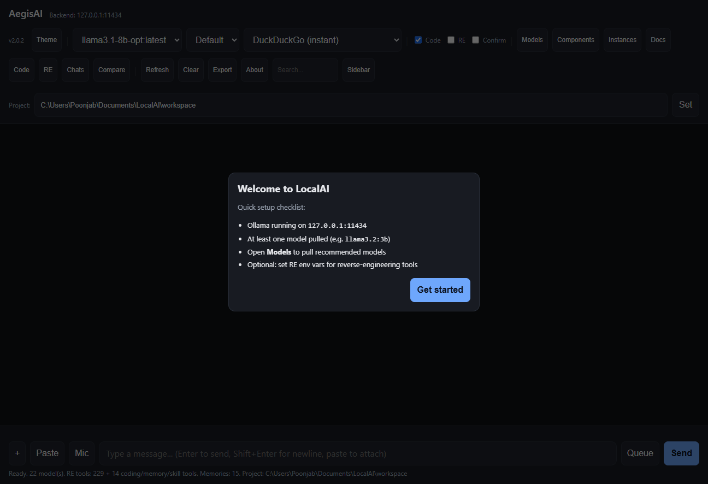

# AegisAI

  [](https://github.com/sponsors/user6811992)

A local AI web UI powered by [Ollama](https://ollama.com), with a built-in chat interface, search engine integration, model management, and reverse-engineering tools. Runs entirely on your machine — no cloud, no telemetry.

## Features

- **Chat UI** — clean, responsive web interface with thinking-block display, Markdown rendering, and code highlighting
- **Model management** — pull models from Ollama or HuggingFace, one-click quick-pull for recommended models, installed-models list
- **Search integration** — 9 keyless search engines (DuckDuckGo, Bing, Google, etc.) + optional LangSearch API
- **Reverse engineering** — 229 RE tools via REA MCP (binaries, JS/Electron, Android, firmware, etc.)
- **Agent tool-call loop** — automatic tool execution with fallback parsing for uncensored models
- **PWA** — installable as a progressive web app on mobile and desktop
- **Mobile-friendly** — safe-area insets, touch targets, install hint banner
- **No telemetry** — zero phone-home, analytics, or tracking code
- **Portable** — auto-generates paths on install, no hardcoded usernames
- **Agent streaming** — live SSE token/thinking/tool events, token usage stats, context meter, compaction indicator, tool log, web citations, reasoning display
- **Chat management** — auto-save, rename, export, delete; Memory & Skills panels with add/edit/delete
- **Settings panel** — agent tool budget, enable/disable tool sources (RE, Ghidra, Craft, Awesome-RE), export/import full backup (JSON)
- **RAG reindex** — re-embed an entire collection with the current embedding model after a model change
- **Safety** — DOMPurify sanitization for Markdown, client-disconnect abort on proxy, Docker healthchecks and named volumes

## Supported Models

Tested with:
- `llama3.2:3b`, `qwen2.5:14b`, `qwen2.5-coder:14b`, `qwen2.5-coder:7b`, `mistral:7b`, `phi3:mini`, `gemma2:9b`, `deepseek-coder:6.7b`, `deepseek-coder-v2:16b`, `deepseek-r1:14b`
- Uncensored: `huihui_ai/qwen2.5-coder-abliterate:7b`, `huihui_ai/deepseek-r1-abliterated:8b`
- Vision: `moondream`, `gemma3:4b`
- Embeddings: `nomic-embed-text`

## Quick Start

### Prerequisites
- [Node.js](https://nodejs.org) 18+
- [Ollama](https://ollama.com/download) installed and running

### Install (Windows — Inno Setup installer, recommended)
Download `AegisAI-Setup-<version>.exe` from the [Releases](https://github.com/user6811992/LocalAI/releases) page and run it. The installer:
- Checks for Node.js and Ollama (offers to download if missing)
- Optionally bundles a portable Node.js runtime (zero prerequisites)
- Copies the application, runs `npm install`
- Lets you pick which AI models to download (optional, ~38 GB total)
- Creates desktop and Start Menu shortcuts
- Optionally enables LAN access and auto-start

### Install (Windows — script installer, legacy)
```bash
git clone https://github.com/user6811992/LocalAI.git
cd LocalAI
npm install
```

### Install (Linux / macOS — from source)
```bash
git clone https://github.com/user6811992/LocalAI.git
cd LocalAI
npm install
```

### Install (macOS — .dmg, coming soon)
Download `AegisAI-<version>.dmg` from the [Releases](https://github.com/user6811992/LocalAI/releases) page, open it, and drag AegisAI to Applications. Build locally with `bash installer/build-dmg.sh` (requires `create-dmg`: `brew install create-dmg`).

### Install (Linux — AppImage, coming soon)
Download `AegisAI-<version>-x86_64.AppImage` from the [Releases](https://github.com/user6811992/LocalAI/releases) page, make it executable (`chmod +x`), and run it. Build locally with `bash installer/build-appimage.sh` (requires `appimagetool`).

### Run
```bash
# Start Ollama (if not running)
ollama serve

# Start the web UI
node server.js
```

Open http://127.0.0.1:8080 in your browser.

### Pull a model
```bash
ollama pull llama3.2:3b
```
Or use the **Models** button in the web UI.

## Backends (multi-backend support)

By default AegisAI talks to Ollama, but the server can also drive any
OpenAI-compatible backend. Set the environment variables before starting:

| `BACKEND_TYPE` | Backend | Notes |
|---|---|---|
| `ollama` (default) | Ollama | Native API |
| `llamacpp` | llama.cpp server | OpenAI-compatible (`/v1/...`) |
| `lmstudio` | LM Studio | OpenAI-compatible |
| `openai` | Any OpenAI-compatible endpoint | Generic |

```bash
# Example: llama.cpp
BACKEND_TYPE=llamacpp BACKEND_URL=http://127.0.0.1:8081 node server.js
```

The adapter normalizes model listing, chat (streaming + tool calls), and model
info to the Ollama shape the UI expects. Note: the UI's model dropdown is
proxied to Ollama's `/api/tags`, so for OpenAI-compatible backends the list may
be empty even though chat works — set the model name in the UI or via the backend.

**Selecting a backend during installation:** the Windows (Inno/VBS/HTA), macOS,
Linux, and Docker installers all prompt for the backend (Ollama, llama.cpp,
LM Studio, or OpenAI-compatible) and write a `backend.txt` (or set
`BACKEND_TYPE`/`BACKEND_URL` env vars) so the launcher and server start with
the right backend. You can change it later by editing `backend.txt` in the app
folder or setting `BACKEND_TYPE`/`BACKEND_URL` before starting the server.

### Intel Arc GPUs

Intel Arc is best supported through **llama.cpp with the SYCL/oneAPI backend**:

1. Build/run llama.cpp with SYCL enabled (`-DGGML_SYCL=ON`) and start `llama-server`.
2. Point AegisAI at it:
   ```bash
   BACKEND_TYPE=llamacpp BACKEND_URL=http://127.0.0.1:8080 node server.js
   ```
   (use the port `llama-server` listens on).

**LM Studio** also supports Intel Arc (via Vulkan/DirectML depending on the
model) — use `BACKEND_TYPE=lmstudio`.

**Ollama** has experimental/limited Intel Arc support on recent versions via
oneAPI; if your Ollama build detects the Arc, the default `BACKEND_TYPE=ollama`
works with no extra configuration.

## Docker (cross-platform)

Run LocalAI with Docker (works on Windows, macOS, Linux):

```
docker compose up -d
```

This starts:
- **Ollama** on port 11434
- **LocalAI** on port 8080

Pull a model:
```
docker exec -it <ollama-container> ollama pull llama3.2:3b
```

Or use the Models button in the web UI.

All app data (memory, chats, RAG store, skills, auth, search config) persists in the `aegisai_data` named volume at `/app/data`, and the reverse-engineering workspace in the `aegisai_workspace` volume at `/app/workspace` — no per-file volume mounts needed. The data directory is overridable via the `AEGISAI_DATA_DIR` env var.

## Remote Access

### Same Wi-Fi (LAN)
Open `http://<your-pc-ip>:8080` on any device on the same network.

### Tailscale (recommended for remote)
Install [Tailscale](https://tailscale.com) on your PC and devices for a private VPN. Both will get `100.x.x.x` addresses.

### Cloudflare Quick Tunnel (no domain needed)
```bash
cloudflared tunnel --url http://localhost:8080
```

## Reverse Engineering Tools

Requires [REA](https://github.com/morluto/rea) installed separately. Set the following environment variables:

```bash
GHIDRA_INSTALL_DIR=C:\Ghidra\ghidra_12.1.4_PUBLIC
JAVA_HOME=C:\Program Files\Eclipse Adoptium\jdk-21.0.13.9-hotspot
REA_JADX_MCP_JAR=C:\Tools\jadx-mcp\jadx-headless-mcp-0.7.1-all.jar
```

The web UI's "RE tools" checkbox enables agent mode with RE tools from REA, plus Ghidra (GhidrAssistMCP) and Craft Anything when they are running. Each agent request is limited to a tool budget (default 64 tools, including the built-in coding tools) so small models are not overwhelmed. Raise it with `AEGISAI_TOOL_BUDGET`.

### Clean Room / Deep Mode

AegisAI supports two reverse-engineering modes, inspired by [Craft Anything](https://github.com/storytold/craft-anything):

- **Deep mode** (default): Full access to RE tools — reads binaries, source code, files, and memory. Use for your own projects and authorized analysis.
- **Clean room mode**: The AI agent is instructed NOT to read original source code or files. It works only from visible behavior (screenshots, UI layout, text content, observable functionality). Toggle via the "Clean room" checkbox next to Code/RE. Useful for interoperability work where you need to avoid copying proprietary code.

Toggle in the toolbar: check "Clean room" to enable. The agent's system prompt is automatically updated.

### Reverse-Engineered Project Search

AegisAI includes a searchable index of **17,000+ reverse-engineered projects** from [awesome-reverse-engineered](https://github.com/alexgaoth/awesome-reverse-engineered) by Alex Gao. Access it via the **RE** button in the web UI:

- Search by product name, vendor, or protocol
- Filter by category (20 categories: RE Tooling, File Formats, Game Decompilations, etc.)
- Preview project READMEs directly in the UI
- Data is cached locally (~7.5MB) and refreshed automatically when older than 24 hours
- Optional: set `GITHUB_TOKEN` env var for higher GitHub API rate limits (README previews)

### Companion RE Tools (Optional)

AegisAI works with several external reverse-engineering tools. These are **not bundled** but can be installed separately for enhanced capabilities:

| Tool | Description | Link |
|------|-------------|------|
| **GhidrAssistMCP** | Native MCP server for Ghidra (100+ tools, resources, prompts). Optional integration available when Ghidra 12.0/12.1 + Java 25+ is installed. | [github.com/symgraph/GhidrAssistMCP](https://github.com/symgraph/GhidrAssistMCP) |
| **GhidrAssist** | LLM extension for Ghidra with built-in chat UI | [github.com/symgraph/GhidrAssist](https://github.com/symgraph/GhidrAssist) |
| **IDAssist** | AI-powered reverse engineering plugin for IDA Pro | [github.com/symgraph/IDAssist](https://github.com/symgraph/IDAssist) |
| **BinAssist** | LLM assistance plugin for Binary Ninja | [github.com/symgraph/BinAssist](https://github.com/symgraph/BinAssist) |
| **REA** | Agentic RE toolset (229 tools) — bundled via MCP | [github.com/morluto/rea](https://github.com/morluto/rea) |
| **Craft Anything** | 320 RE tools (native, .NET, Java, Android, Apple, Electron/JS, websites, firmware, packet captures, databases, game files) — optional MCP via craft-anything-cli | [github.com/storytold/craft-anything](https://github.com/storytold/craft-anything) |

## Installer (Linux / macOS)

A bash installer is included: **`install.sh`**. Works on Linux and macOS.

```
bash install.sh
```

It provides:
- Interactive install location selection
- Prerequisite checks (Node.js, Ollama)
- Optional model pull (recommended models in order)
- Desktop shortcut (`.desktop` on Linux, `.command` on macOS)
- Optional auto-start (systemd user service on Linux, launchd on macOS)
- Optional immediate launch

Uninstall with `bash uninstall.sh`.

## Installer (Windows Shell)

A standard Windows-shell installer is included in the repo: **`install.vbs`**. It runs under `wscript.exe` (the standard Windows Script Host) — no PowerShell, no console window. It uses native Windows dialogs and:
- Asks where to install (interactive folder selection) and copies the app files there
- Checks for Node.js and Ollama and reports what's missing
- Optionally pulls all recommended models in the proper order (llama3.2, qwen2.5, mistral, etc.)
- Prompts whether to create a **desktop shortcut** (your selection)
- Optionally launches LocalAI immediately after install
- Detects an existing install and offers a core-file update (preserves models & shortcuts)
- Scans drives for existing tools (Ghidra, jadx, Ollama, Node, Java) and reports findings
- Writes an `install.log` for troubleshooting
- Includes `uninstall.vbs` to remove shortcuts (and optionally the app folder)
- Includes `tray.vbs` for a system-tray icon (via PowerShell NotifyIcon)
- Creates `.lnk` shortcuts via `WScript.Shell` (standard Windows shell)

Run it by double-clicking `install.vbs`. Or from a command prompt:

```
wscript.exe install.vbs
```

**Alternative: HTA Installer with Progress Bar**

For a richer installation experience with a visual progress bar, use `install.hta` instead. It provides:
- Visual progress bar showing installation steps
- Real-time status log
- Folder browser dialog
- All the same features as install.vbs (model pull, shortcuts, firewall, auto-start)

Run it by double-clicking `install.hta`. Or from a command prompt:

```
mshta.exe install.hta
```

The launcher itself is **`launcher.vbs`** (Windows Script Host / standard Windows shell) and is portable — it resolves all paths relative to its own location and starts Ollama, the web UI, and the Edge app window. Desktop shortcuts created by the installer point at `launcher.vbs`.

> Note: `tray.ps1` is retained (used by `tray.vbs` for the system-tray icon). The legacy `launch-gui.ps1` and `start.bat` have been removed in favor of `install.vbs` + `launcher.vbs`.

## Troubleshooting (Windows)

### "Windows protected your PC" (SmartScreen)
The installer (`install.vbs`) and launcher are not code-signed, so SmartScreen may warn on first run.

- Click **More info** then **Run anyway**.
- Or right-click the file → **Properties** → check **Unblock** → OK, then run.

Code signing is not included in this project; if you need it, sign the `.vbs` files with your own certificate (`signtool`).

### Ollama / Node not found
The installer checks for `node` and `ollama` on PATH. If missing, install them:
- Node.js: https://nodejs.org
- Ollama: https://ollama.com/download

Then re-run `install.vbs`.

## Screenshots




## Security / Auth

LocalAI **binds to localhost (`127.0.0.1`) by default**. For LAN access, set `HOST=0.0.0.0` (the Windows installer does this when you choose LAN access) and also set a token. Without a token the UI works only on the local machine.

| Variable | Purpose |
|---|---|
| `HOST` | Bind address (default `127.0.0.1`) |
| `LOCALAI_TOKEN` | Require this token on every request |
| `AEGISAI_PROJECT_ROOT_ALLOWLIST` | Directories the agent project root may point into (`;` separated) |
| `AEGISAI_MAX_BODY` | Max request body in bytes (default 100 MB) |
| `AEGISAI_TOOL_BUDGET` | Max tools sent to the model per agent request (default 64) |

To set a token:

**Environment variable:**
```
LOCALAI_TOKEN=your-secret-token node server.js
```

**Or create `auth.json` in the app folder:**
```json
{ "token": "your-secret-token" }
```

When a token is set, all API requests require `X-Auth-Token: <token>` header. The web UI will prompt for the token on first load and store it in localStorage.

**Rate limiting:** 120 requests/minute per IP (built-in).

**LAN access warning:** If no token is set and the server binds to a non-loopback address, a warning is printed to the console. Use Tailscale or Cloudflare Tunnel for secure remote access.

**Code execution:** `/api/run-code` and the Python tools run code without a sandbox by default, as your user. Set `AEGISAI_SANDBOX=docker` to run code in an isolated container (requires Docker). See [SECURITY.md](SECURITY.md).

## Privacy

- No telemetry, analytics, or tracking
- No cloud dependencies — everything runs locally
- No hardcoded identifiers — paths auto-generate on install
- `search-config.json` ships with empty keys — add your own

## Acknowledgments

Special thanks to:

- **[OpenCode](https://opencode.ai)** - the AI coding agent harness that helped build, debug, and ship this project (installer, launcher, UI features, and more).
- **[Beam.ai](https://beam.ai)** - the model provider powering the coding/reasoning assistance behind this work.
- **[Ollama](https://ollama.com)** - for making local LLMs easy to run.
- **[HuggingFace](https://huggingface.co)** - for the model hub and open weights.
- **[morluto/rea](https://github.com/morluto)** - for the REA reverse-engineering toolset.
- **[Alex Gao](https://github.com/alexgaoth)** - for [awesome-reverse-engineered](https://github.com/alexgaoth/awesome-reverse-engineered), a curated index of 17,000+ reverse-engineered projects (MIT code license, CC0 data license). Integrated search, category browsing, README preview, and project lookup help users find existing RE work before starting their own. Data is cached locally and refreshed automatically when older than 24 hours.
- **[symgraph (RevGraph Labs)](https://github.com/symgraph)** - for [GhidrAssistMCP](https://github.com/symgraph/GhidrAssistMCP) (MIT license), a native MCP server extension for Ghidra providing 100+ granular RE tools. Optional integration available when Ghidra 12.0/12.1 + Java 25+ is installed.
- **[storytold](https://github.com/storytold)** - for [Craft Anything](https://github.com/storytold/craft-anything) (MIT/Apache-2.0), which inspired the Clean Room/Deep mode concept for reverse engineering. Optional MCP integration available when craft-anything-cli is installed.
- **[Alex Gao](https://github.com/alexgaoth)** - for [awesome-reverse-engineered](https://github.com/alexgaoth/awesome-reverse-engineered), a curated index of 17,000+ reverse-engineered projects (MIT code, CC0 data).
- All other contributors, testers, and the open-source community.

## Support

If you find LocalAI useful, consider sponsoring the project:

- [GitHub Sponsors](https://github.com/sponsors/user6811992) — recurring or one-time
- Star the repo to help others discover it


## License

MIT License — see [LICENSE](LICENSE) for details.

## Third-Party Notices

AegisAI references and integrates with several third-party projects. Their names, trademarks, and branding are owned by their respective creators. AegisAI is not affiliated with or endorsed by any of these projects:

- **[Ollama](https://ollama.com)** — Local LLM runtime (MIT License)
- **[HuggingFace](https://huggingface.co)** — Model hub (Apache 2.0)
- **[morluto/rea](https://github.com/morluto/rea)** — Reverse engineering toolset
- **[Alex Gao / awesome-reverse-engineered](https://github.com/alexgaoth/awesome-reverse-engineered)** — Curated RE index (MIT code, CC0 data)
- **[symgraph / GhidrAssistMCP](https://github.com/symgraph/GhidrAssistMCP)** — Ghidra MCP extension (MIT)
- **[storytold / Craft Anything](https://github.com/storytold/craft-anything)** — RE engine (MIT/Apache-2.0). ArtCraft name/logos are trademarks of the ArtCraft Team.

No third-party logos, trademarks, or branding assets are included in this repository. All references are by name only for factual attribution.

## Contributing

Contributions welcome! Please open an issue or pull request.
